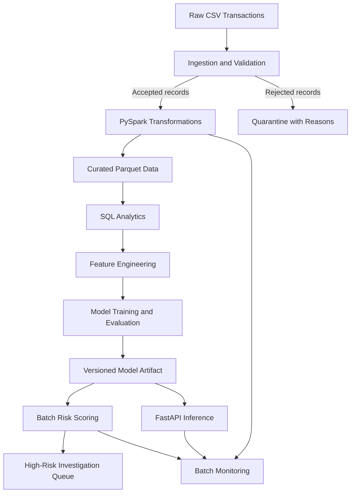

# FinGuard — Financial Transaction Risk Analytics & Fraud Detection Pipeline

FinGuard is a locally runnable, batch-oriented financial transaction risk analytics project built around data engineering and machine learning.

It demonstrates an end-to-end workflow covering data ingestion, validation, quarantine, distributed transformations with Apache Spark, Parquet storage, SQL analytics, model training, batch scoring, monitoring, and API-based inference.

> **Project scope:** This is a production-oriented educational prototype using synthetic data. It is not a production banking or payment-processing system. A model prediction is a risk signal for investigation, not proof of fraud.

## Architecture



## Technology Stack

| Area | Technology |
|---|---|
| Programming language | Python 3.11 |
| Distributed processing | Apache Spark / PySpark 3.5.3 |
| Data manipulation | Pandas, NumPy |
| Storage | Parquet, SQLite |
| Analytics | SQL |
| Machine learning | scikit-learn |
| Model persistence | Joblib |
| API | FastAPI, Pydantic |
| Configuration | YAML |
| Visualization | Matplotlib |
| Testing | pytest |

## Key Features

### 1. Data ingestion and validation
- Reads transaction records from CSV.
- Validates required fields, data types, and business rules.
- Separates accepted and rejected records.
- Preserves rejected records with validation reasons.
- Supports a configurable rejection-rate guardrail.

### 2. PySpark data engineering
- Uses PySpark DataFrames for batch transformations.
- Generates curated transaction data in Parquet format.
- Produces customer and merchant aggregations.
- Separates ingestion and validation from downstream transformations.

### 3. SQL analytics
- Performs transaction-level and aggregated analytics.
- Generates daily, merchant, customer, hourly, high-value, and payment-channel summaries.
- Uses SQLite for pipeline run metadata and history.

### 4. Machine learning
- Builds reusable preprocessing and model pipelines.
- Keeps the fraud label outside the feature matrix.
- Evaluates classification performance.
- Supports threshold selection and reusable model artifacts.
- Provides batch inference using a saved model.

### 5. Risk scoring and investigation queue
- Scores validated transactions.
- Applies a configurable risk threshold.
- Produces a high-risk transaction queue for further review.
- Treats predictions as review signals rather than confirmed fraud decisions.

### 6. Monitoring and observability
- Tracks accepted and rejected records.
- Reports missing values and fraud prevalence when labels are available.
- Summarizes risk-score distributions and high-risk rates.
- Generates monitoring summaries and visualizations.
- Maintains structured application logs and pipeline run metadata.

### 7. API inference
- Exposes model inference through FastAPI.
- Uses Pydantic request validation.
- Provides health and model metadata endpoints.
- Includes interactive API documentation through Swagger UI.

## Repository Structure

```text
FinGuard/
│
├── config/
│   └── config.yaml
│
├── data/
│   └── raw/
│       └── sample/
│           ├── transactions.csv
│           └── DATASET_NOTES.md
│
├── monitoring/
│   └── .gitkeep
│
├── reports/
│   └── .gitkeep
│
├── scripts/
│   └── generate_sample.py
│
├── sql/
│   └── analytics.sql
│
├── src/
│   └── finguard/
│       ├── analytics/
│       ├── api/
│       ├── features/
│       ├── inference/
│       ├── ingestion/
│       ├── models/
│       ├── monitoring/
│       ├── orchestration/
│       ├── storage/
│       ├── transformations/
│       ├── validation/
│       ├── cli.py
│       └── common.py
│
├── tests/
│   ├── unit/
│   └── integration/
│
├── .gitignore
├── pyproject.toml
├── README.md
└── requirements.txt
```

Generated data, trained model artifacts, logs, and scoring outputs are created locally when the pipeline runs. They are excluded from Git to keep the repository focused on source code and reproducibility.

## Dataset

The repository includes a synthetic transaction dataset.

- Generated records: 2,400
- Generator seed: `20261030`
- Fraud labels: synthetic binary target
- Deliberate data-quality defects include a negative amount, invalid category, malformed timestamp, duplicate transaction ID, and missing customer ID.

The synthetic fraud labels use overlapping probabilistic signals. They are intended for demonstrating a machine learning workflow, not representing actual financial crime patterns or real-world fraud prevalence.

## Setup and Installation

### Prerequisites

- Python 3.11
- Java 17 JDK for PySpark 3.5.x
- Git
- Windows PowerShell or a compatible terminal

Ensure `JAVA_HOME` points to your Java installation and that `%JAVA_HOME%\bin` is available on your `PATH`.

### 1. Clone the repository

```powershell
git clone <YOUR-GITHUB-REPOSITORY-URL>
cd FinGuard
```

Replace the placeholder with your actual GitHub repository URL after publishing.

### 2. Create and activate a virtual environment

```powershell
py -3.11 -m venv .venv
.\.venv\Scripts\Activate.ps1
```

If PowerShell blocks activation:

```powershell
Set-ExecutionPolicy -Scope Process -ExecutionPolicy Bypass
.\.venv\Scripts\Activate.ps1
```

### 3. Install dependencies

```powershell
python -m pip install --upgrade pip
pip install -r requirements.txt
pip install -e .
```

### 4. Generate synthetic data

```powershell
python scripts/generate_sample.py
```

### 5. Run the complete pipeline

```powershell
python -m finguard.cli run
```

The pipeline performs ingestion, validation, transformations, analytics, model training, scoring, monitoring, and output publishing according to the project configuration.

### Additional CLI commands

View available commands:

```powershell
python -m finguard.cli --help
```

Score using an existing model:

```powershell
python -m finguard.cli score
```

Run the pipeline without retraining:

```powershell
python -m finguard.cli run --no-train
```

## FastAPI Inference

Start the API after a model has been trained:

```powershell
uvicorn finguard.api.app:app --host 127.0.0.1 --port 8000
```

Open the interactive documentation:

`http://127.0.0.1:8000/docs`

Available endpoints:

| Endpoint | Purpose |
|---|---|
| `GET /health` | API health check |
| `GET /model-info` | Model metadata |
| `POST /predict` | Transaction risk inference |

Example PowerShell request:

```powershell
$body = @{
    transaction = @{
        transaction_id = "API-001"
        customer_id = "C-100"
        transaction_timestamp = "2026-10-30T09:30:00Z"
        amount = 2500
        currency = "INR"
        merchant_category = "electronics"
        payment_method = "card"
        distance_from_home_km = 18.5
        transactions_last_24h = 4
    }
} | ConvertTo-Json -Depth 5

Invoke-RestMethod `
    -Uri http://127.0.0.1:8000/predict `
    -Method Post `
    -ContentType "application/json" `
    -Body $body
```

## Testing

Run the test suite:

```powershell
python -m pytest -v
```

The tests cover unit and integration behavior, including configuration, feature engineering, validation, scoring, publishing, API health, and pipeline failure handling.

PySpark tests require a compatible Java installation.

## Example Local Verification

One successful local execution produced the following results:

| Metric | Observed result |
|---|---:|
| Input transactions | 2,400 |
| Accepted transactions | 2,395 |
| Rejected transactions | 5 |
| Duplicate transaction records | 1 |
| Scored transactions | 2,395 |
| High-risk transactions | 97 |
| Model version | `finguard-1.0.0` |

These are results from a synthetic demonstration run, not performance claims about real financial transactions.

The project test suite also passed 11 tests in a recorded local run. Re-run the tests and pipeline in your own environment to verify the current checkout.

## Guardrails and Engineering Considerations

- Invalid records are quarantined with validation reasons.
- Missing required data and invalid configurations are handled through validation.
- A configurable rejection-rate threshold can stop a batch.
- Scoring requires an available model artifact.
- Empty scoring input is handled.
- Repeated runs use full-refresh output publishing rather than append-only processing.
- Pipeline run metadata is stored in SQLite.
- Model predictions are not treated as confirmed fraud.

### Known limitations

This is a local prototype, not a fully hardened production deployment.

- Multi-output publishing is not an atomic transaction; a failure can leave partial files.
- Late-arriving updates would require a watermark and merge/upsert strategy.
- Monitoring is batch-oriented and does not provide automatic alerting.
- Model performance monitoring requires later verified labels.
- Drift alone does not establish model failure.
- SQLite and local Pandas workflows are intended for small demonstrations, not bank-scale workloads.
- The API binds to localhost by default.

A real external deployment would require authentication, authorization, TLS, rate limiting, secrets management, access controls, encryption, audit controls, resilience, and infrastructure monitoring.

## Resume Highlights

Use these bullets only when you can explain and demonstrate the corresponding implementation:

- Built a batch financial transaction analytics pipeline using PySpark DataFrame transformations, data validation, quarantine handling, Parquet storage, and SQL analytics.
- Implemented a reusable scikit-learn training and inference workflow with model evaluation and risk-threshold-based transaction scoring.
- Developed a FastAPI inference service with Pydantic validation, SQLite pipeline run tracking, structured logging, and batch monitoring.

## Interview Preparation Topics

Be prepared to explain:

1. Why PySpark DataFrames are used for batch transformations.
2. How invalid records are quarantined and why they should not silently disappear.
3. How Parquet differs from CSV for analytical workloads.
4. How the feature matrix avoids target leakage.
5. How class imbalance affects fraud detection.
6. Why precision, recall, and threshold selection matter.
7. What idempotency means in a full-refresh pipeline.
8. Why data drift, prediction drift, and model performance degradation are different.
9. Why local API inference is not equivalent to secure production deployment.

## Verification Checklist

- [ ] Python 3.11 and Java 17 are available.
- [ ] Dependencies install successfully.
- [ ] Synthetic data generation works.
- [ ] Unit and integration tests pass.
- [ ] Full pipeline completes successfully.
- [ ] Repeated runs produce expected output counts.
- [ ] Model artifacts are generated locally.
- [ ] Batch scoring and investigation queue work.
- [ ] API health, model metadata, and prediction endpoints work.
- [ ] Rejected records and monitoring outputs are inspected.

---

**FinGuard — A hands-on demonstration of financial data engineering, analytics, and machine learning.**